# Escalamiento en Azure con Máquinas Virtuales y Balanceador de Carga

**Escuela Colombiana de Ingeniería Julio Garavito  Arquitecturas de Software (ARSW)**

**Integrantes:**
- Esteban Valente Arenas
- Keyla Yunuette Serna Illescas

El informe completo, con todas las capturas, está en [`Informe_Lab_Escalabilidad_Azure.pdf`](Informe_Lab_Escalabilidad_Azure.pdf). Todas las evidencias están en la carpeta [`evidencias`](evidencias). El enunciado original del laboratorio está en [`ENUNCIADO.md`](ENUNCIADO.md).

---

## Escenario de calidad

> **Escalabilidad:** cuando un conjunto de usuarios consulta un enésimo número (superior a 1000000) de la secuencia de Fibonacci de forma concurrente y el sistema se encuentra bajo condiciones normales de operación, todas las peticiones deben ser respondidas y el consumo de CPU del sistema no puede superar el 70 %.

## Condiciones del entorno

El laboratorio se hizo con una suscripción **Azure for Students**, que obligó a ajustar algunos pasos del enunciado:

- Solo permite 5 regiones: West US 2, Spain Central, Mexico Central, France Central y Brazil South. Chile Central fue rechazada (`RequestDisallowedByAzure`).
- Límite de **6 vCPU** y **3 IPs públicas** por región. La solicitud de aumento de cuota fue rechazada.
- Los tamaños B1ls y B4ms no estaban disponibles. Se usaron **B2ats_v2** (inicial) y **D4s_v4** (escalado).
- El SKU Básico del balanceador fue retirado en 2025, así que se usó el **SKU Estándar**.

---

## Parte 1 — Escalabilidad vertical

VM `VERTICAL-SCALABILITY` en **Mexico Central**, Ubuntu 24.04, Node.js v24.22.1 + forever.

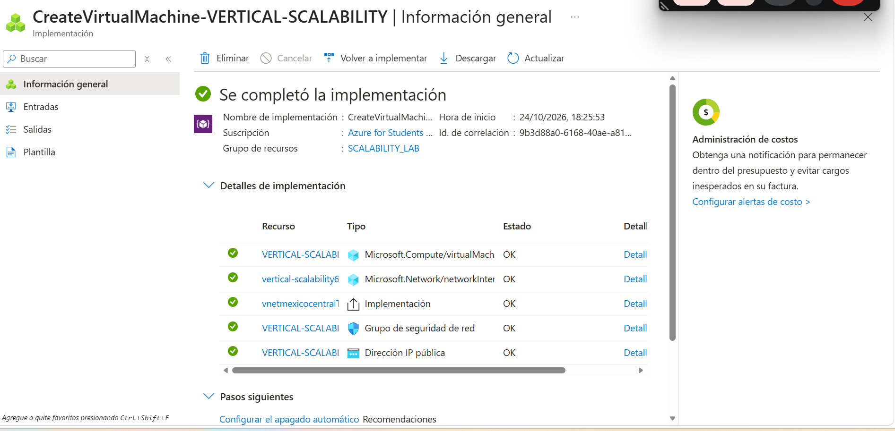
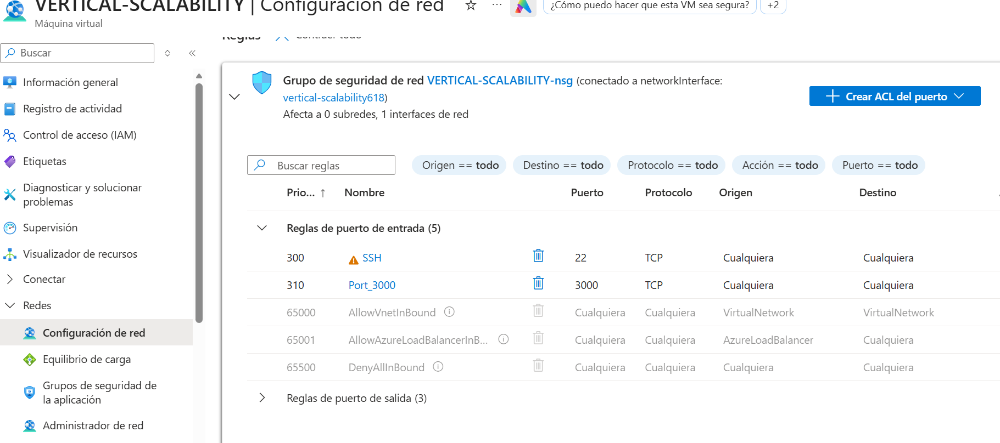
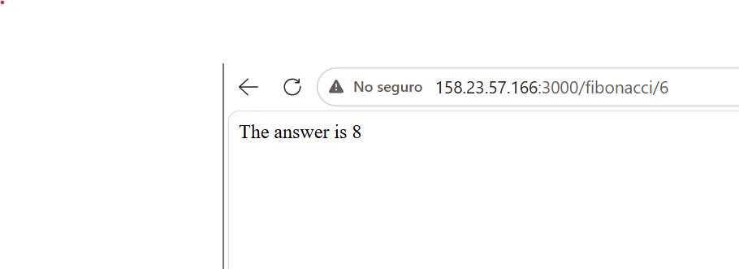

### Tiempos de respuesta (una petición a la vez)

| N | B2ats_v2 (2 vCPU) | D4s_v4 (4 vCPU) |
|---|---|---|
| 1000000 | 5.79 s | 8.52 s |
| 1010000 | 5.90 s | 8.65 s |
| 1020000 | 5.86 s | 8.78 s |
| 1030000 | 6.07 s | 8.96 s |
| 1040000 | 6.19 s | 9.10 s |
| 1050000 | 6.33 s | 9.28 s |
| 1060000 | 6.42 s | 9.48 s |
| 1070000 | 6.44 s | 9.64 s |
| 1080000 | 6.75 s | 9.81 s |
| 1090000 | 6.92 s | 9.99 s |
| **Promedio** | **6.27 s** | **9.22 s** |

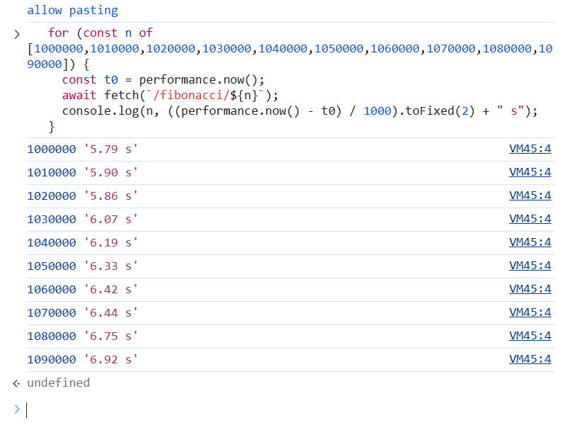
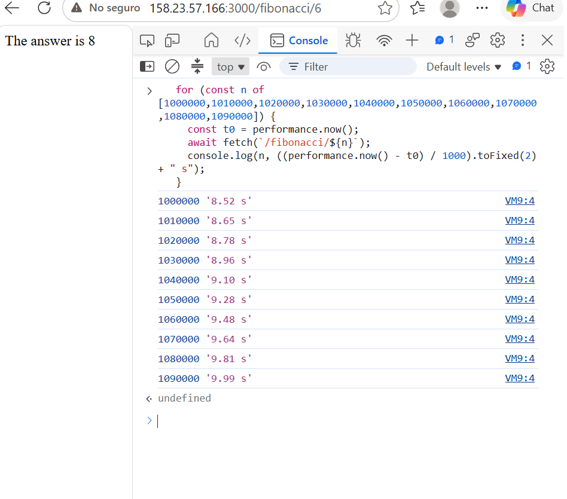

### Consumo de CPU

Con B2ats_v2 la CPU llegó a ~50 % (48.37 % y 50.02 %) y con D4s_v4 a ~25 % (25.02 %, 24.35 % y 25.24 %). En ambos casos es **un núcleo al 100 %**: Node.js ejecuta el cálculo en un solo hilo.

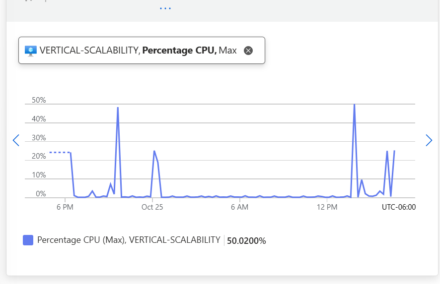

### Pruebas con Newman

| Prueba | Exitosas | Promedio |
|---|---|---|
| B2ats_v2, 2 en paralelo | 20 de 20 (100 %) | 10.9 s |
| D4s_v4, 2 en paralelo | 11 de 20 (55 %) | 11.5 s |
| D4s_v4, 4 en paralelo | 21 de 40 (52.5 %) | 25.6 s |

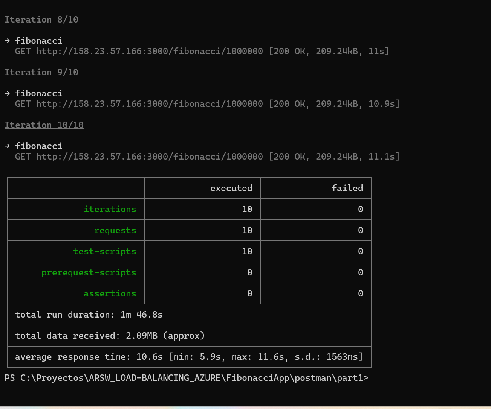
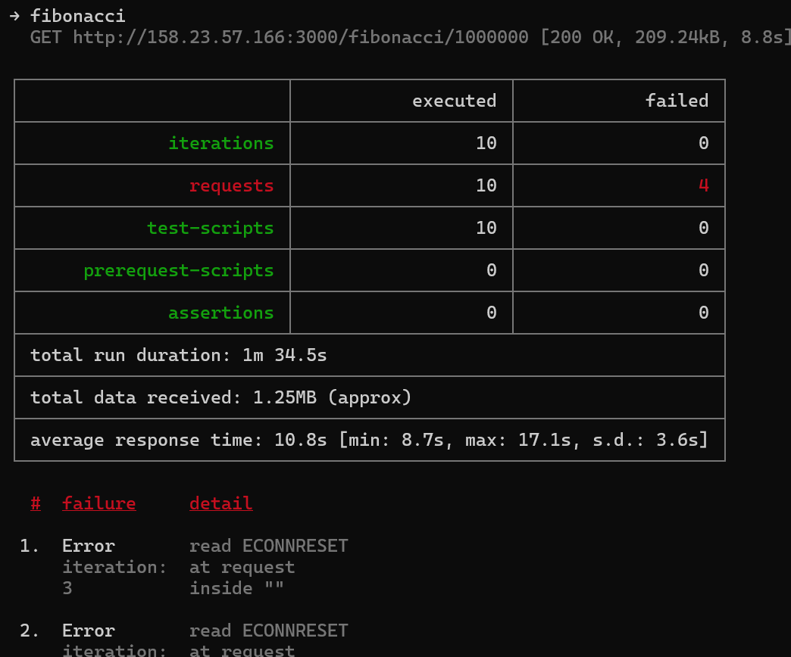

Los fallos (`ECONNRESET`) no se deben a que la app se cayera: `forever` mostraba 34 minutos de actividad y en el log solo aparecían ~10 de las 20 peticiones. Node.js atiende una petición a la vez; mientras calcula (~8.7 s en D4s_v4) la otra petición espera en fila, y Node cierra las conexiones keep-alive que no atiende en ~5 s. Con B2ats_v2 cada cálculo tarda ~6 s y no hubo fallos.

### Escalamiento vertical

Se escaló de **B2ats_v2** (2 vCPU, 1 GiB, 7,52 US$/mes) a **D4s_v4** (4 vCPU, 16 GiB, 154,03 US$/mes). Al cambiar el tamaño, la VM se reinició y la app se cayó hasta volver a iniciarla. Al final se regresó al tamaño inicial.

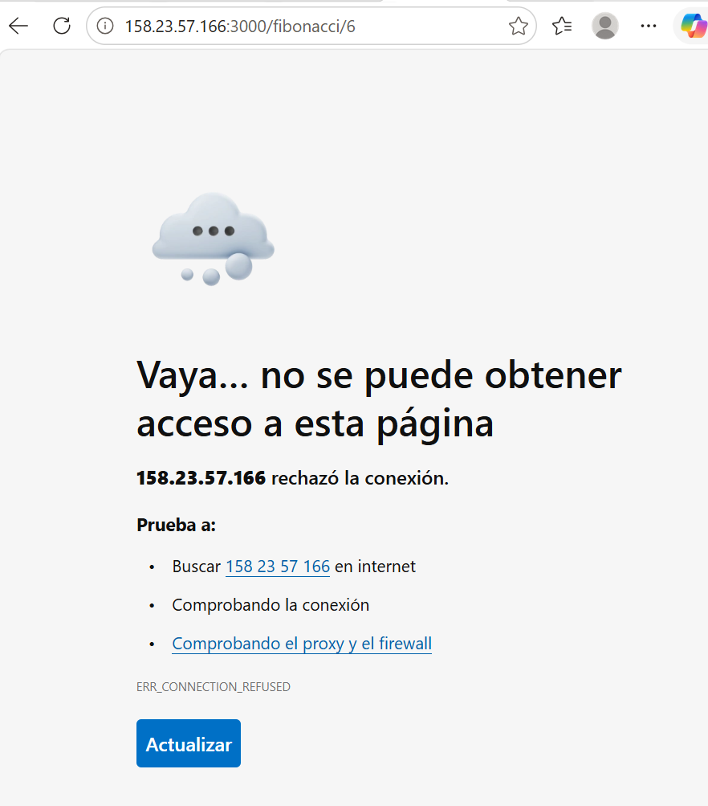

**Conclusión Parte 1:** el escalamiento vertical **no cumple** el escenario de calidad. La VM grande usa solo el 25 % de su CPU, es ~47 % más lenta (núcleos más lentos), falla en ~45 % de las peticiones concurrentes y cuesta ~20 veces más.

### Respuestas Parte 1

**1. ¿Cuántos y cuáles recursos crea Azure junto con la VM?**
Seis: la máquina virtual, el disco del sistema operativo, la interfaz de red (NIC), la IP pública, el grupo de seguridad de red (NSG) y la red virtual con su subred.

**2. ¿Para qué sirve cada recurso?**
La VM ejecuta el sistema operativo y la app. El disco guarda el sistema y los archivos. La NIC conecta la VM a la red virtual y tiene sus IPs. La IP pública permite llegar a la VM desde internet. El NSG es el firewall que permite o bloquea tráfico por puerto. La red virtual y su subred son la red privada donde vive la VM.

**3. ¿Por qué se cae la app al cerrar SSH? ¿Por qué hay que crear la Inbound port rule?**
El proceso queda ligado a la sesión SSH; al cerrarla, el sistema envía SIGHUP y la app termina. Por eso se usa `forever`, que la ejecuta en segundo plano. La regla es necesaria porque el NSG bloquea por defecto todo puerto de entrada no permitido, y al crear la VM solo se abrió el 22.

**4. Tabla de tiempos y por qué tarda tanto.**
Ver la tabla de arriba. La función hace N−1 sumas con enteros de precisión arbitraria (`big-integer`). Para N = 1000000 el resultado tiene más de 200 000 dígitos (la respuesta pesa 209 KB) y cada suma recorre todos los dígitos, así que el trabajo crece aproximadamente con N². No guarda resultados y bloquea el único hilo de Node.

**5. Consumo de CPU.**
~50 % con 2 vCPU y ~25 % con 4 vCPU: un núcleo al 100 %. El cálculo es intensivo en CPU, pero Node.js usa un solo hilo y nunca aprovecha más de un núcleo.

**6. Resumen de Postman: tiempos y fallos.**
Con B2ats_v2 y 2 en paralelo no hubo fallos, pero el promedio subió a ~11 s (el doble de una petición sola) porque una petición espera a la otra. Con D4s_v4 fallaron 9 de 20 con `ECONNRESET`, por el cierre de las conexiones keep-alive que esperaban en fila más de ~5 s.

**7. Diferencia entre B2ms y B1ls.**
B1ls: 1 vCPU, 0,5 GiB. B2ms: 2 vCPU, 8 GiB. Ambas son *burstable* (serie B): tienen un rendimiento base y acumulan créditos de CPU para ráfagas. El rendimiento base de B1ls es muy bajo (~5 %) y el de B2ms mucho mayor (~60 %), así que B2ms soporta carga sostenida; también admite más discos, IOPS y red, y cuesta ~16 veces más. En nuestro caso: B2ats_v2 (burstable, AMD EPYC, barata) contra D4s_v4 (uso general, sin créditos, Intel Xeon, ~20 veces más cara).

**8. ¿Aumentar el tamaño es buena solución? ¿Qué pasa con la app?**
No. La app usa un solo hilo, así que los núcleos extra no sirven, y los núcleos de D4s_v4 son más lentos. Al cambiar el tamaño la VM se reinicia y la app se cae hasta volver a iniciarla.

**9. ¿Qué pasa con la infraestructura al cambiar el tamaño?**
Azure detiene la VM, puede moverla a otro servidor físico y la vuelve a encender. Esto implica tiempo sin servicio, pérdida de procesos y datos en memoria o en el disco temporal, posible cambio de IP si es dinámica, depender de que el tamaño esté disponible en la región y un costo mucho mayor. Además, hay un límite máximo de tamaño.

**10. ¿Hubo mejora en CPU o tiempos?**
No. El porcentaje bajó de ~50 % a ~25 % solo porque hay más núcleos sin usar. Los tiempos empeoraron (6.27 s → 9.22 s) y aparecieron fallos.

**11. Con 4 en paralelo, ¿es porcentualmente mejor?**
No. Los fallos pasaron de 45 % a 47.5 % y el promedio de 11.5 s a 25.6 s. La CPU siguió en 25 %.

---

## Parte 2 — Escalabilidad horizontal

Región **Spain Central**, grupo de recursos `SCALABILITY_LAB_HORIZONTAL`.

| Recurso | Configuración |
|---|---|
| Red virtual | `SCALABILITY_LAB_VNET` 10.0.0.0/16, subred `default` 10.0.0.0/24 |
| Balanceador | `SCALABILITY_LAB_LB`, SKU Estándar, público, regional, IP **68.221.5.170** (zone-redundant) |
| Regla | `FIBONACCI_LB_RULE`, TCP 80 → 3000, sin persistencia de sesión |
| Sondeo | `FIBONACCI_HEALTH_PROBE`, TCP 3000 cada 5 s |
| NSG | `SCALABILITY_LAB_NSG` (puertos 22 y 3000), compartido por las 3 VMs |
| VM1 | B2ats_v2, zona 1, IP privada 10.0.0.4 |
| VM2 | B2ats_v2, zona 3, IP privada 10.0.0.5 |
| VM3 | B2ats_v2, zona 1, IP privada 10.0.0.6, sin IP pública |

Ajustes por la suscripción:
- B2ats_v2 solo existe en las zonas 1 y 3, y la zona 2 no ofrece tamaños (`NotAvailableForSubscription`). Por eso las VMs quedaron en **2 zonas**.
- Límite de 3 IPs públicas: **VM3 no tiene IP pública** (el tráfico le llega por el balanceador). Como no tenía internet, Node.js y la app se le copiaron desde VM1 por la red privada.
- Límite de 6 vCPU: **no se pudo crear la VM4**.

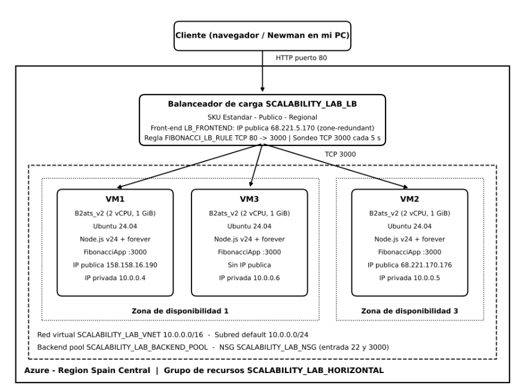

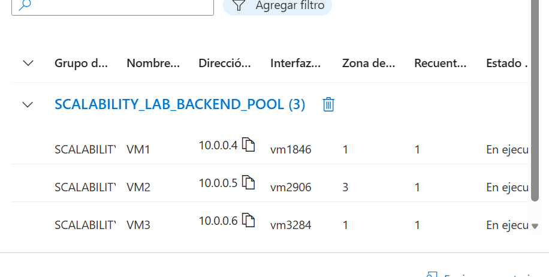
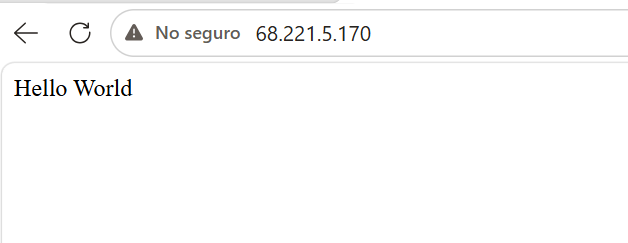
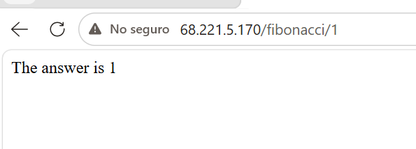

### Pruebas con Newman contra el balanceador

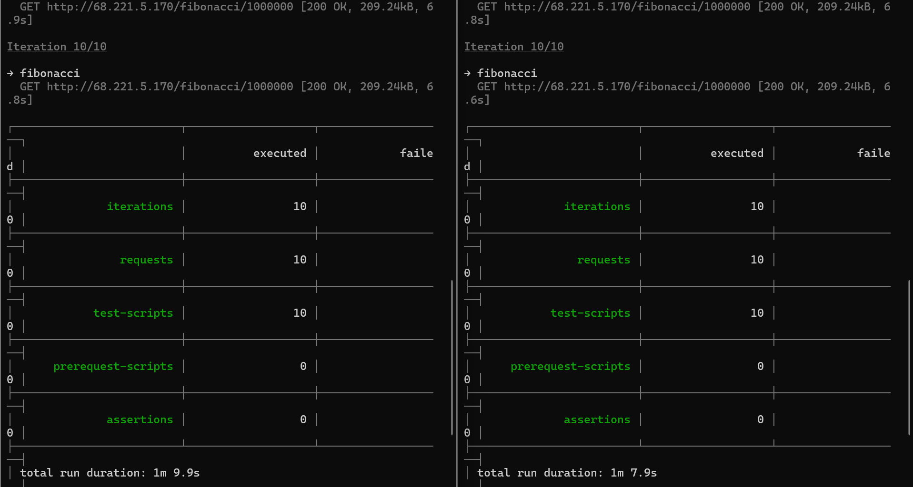
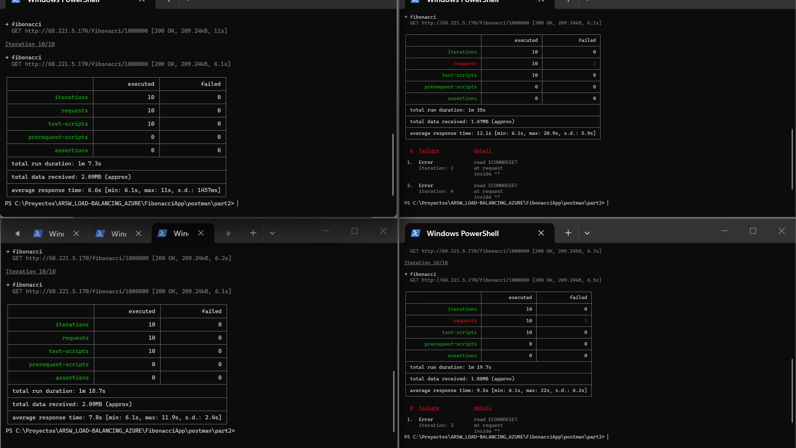

| VM | CPU máx. 2 en paralelo | CPU máx. 4 en paralelo |
|---|---|---|
| VM1 | 46.28 % / 44.19 % | 48.21 % |
| VM2 | 37.63 % | 39.20 % |
| VM3 | 44.24 % | 46.49 % |

Cada ejecución de Newman abre una sola conexión y el balanceador asigna cada conexión a una VM. Con 2 en paralelo trabajaron 2 VMs; con 4, las 3.

### Informe comparativo (punto 2)

| Prueba | 1 VM B2ats_v2 | 1 VM D4s_v4 | Balanceador + 3 VMs |
|---|---|---|---|
| 2 en paralelo: éxito | 100 % | 55 % | **100 %** |
| 2 en paralelo: promedio | 10.9 s | 11.5 s | **6.8 s** |
| 4 en paralelo: éxito | — | 52.5 % | **92.5 %** |
| 4 en paralelo: promedio | — | 25.6 s | **9.0 s** |
| CPU máxima | 50.02 % | 25.24 % | 48.21 % por VM |
| Costo aprox. | 7,52 US$/mes | 154,03 US$/mes | ~56 US$/mes |

El costo horizontal incluye 3 VMs B2ats_v2 (26,73 US$/mes), el balanceador Estándar (~18 US$/mes) y 3 IPs públicas (~3,65 US$/mes cada una).

**Por qué aumentó la tasa de éxito (punto 3):** la carga ya no la atiende un solo proceso de Node.js; cada VM tiene su propio proceso y su propio núcleo, y el balanceador reparte las conexiones. Con 4 conexiones y 3 VMs, dos conexiones comparten VM y ahí aparecieron los 3 fallos; con una cuarta VM cada conexión tendría su propia máquina.

**Conclusión Parte 2:** con 2 usuarios concurrentes se **cumple** el escenario de calidad (todas las peticiones respondidas, CPU < 70 %), con tiempos cercanos a los de una petición individual y casi 3 veces más barato que la VM grande.

### Respuestas Parte 2

**1. Tipos de balanceadores, SKU y por qué necesita IP pública.**
Azure Load Balancer (capa 4, TCP/UDP, público o interno, regional o global), Application Gateway (capa 7, HTTP/HTTPS, enrutamiento por URL y WAF), Front Door (capa 7 global) y Traffic Manager (balanceo por DNS). El SKU es el nivel del servicio: Básico (sin zonas ni SLA, retirado en septiembre de 2025), Estándar (zonas, SLA 99.99 %, seguro por defecto, hasta 1000 instancias, reglas de salida) y Gateway (para encadenar aplicaciones de red de terceros). Necesita IP pública porque es el único punto de entrada desde internet: los clientes usan una sola dirección sin conocer las VMs.

**2. Propósito del Backend Pool.**
Es el conjunto de VMs entre las que se reparte el tráfico. Agregar o quitar VMs del pool es la forma de escalar horizontalmente sin cambiar la IP que usan los clientes.

**3. Propósito del Health Probe.**
Revisa periódicamente cada VM; si una no responde, el balanceador deja de enviarle tráfico hasta que se recupere. Se usó TCP y no HTTP porque, mientras Node calcula, no puede responder HTTP y la VM se marcaría como caída.

**4. Propósito de la Load Balancing Rule y tipos de persistencia de sesión.**
La regla define qué IP y puerto reciben el tráfico (80), a qué pool y puerto se envía (3000), el protocolo y el sondeo. Persistencia: **Ninguna** (hash de 5 valores, cada conexión puede ir a cualquier VM), **IP del cliente** (misma IP → misma VM) e **IP del cliente y protocolo**. Es importante cuando la app guarda estado en memoria, pero perjudica la escalabilidad: como todas nuestras pruebas salen de una sola IP, con persistencia por IP todo habría ido a una sola VM. Por eso se usó Ninguna.

**5. Virtual Network, Subnet, address space y address range.**
La red virtual es una red privada aislada en Azure. La subred es una división de esa red que agrupa recursos con reglas comunes. El address space es el rango total de la red (10.0.0.0/16, 65 536 direcciones) y el address range es la parte asignada a la subred (10.0.0.0/24, 256 direcciones), de donde las VMs reciben su IP privada.

**6. Availability Zones y zone-redundant.**
Son centros de datos físicamente separados dentro de una región, con energía, refrigeración y red independientes. Repartir las VMs en zonas permite que el sistema siga funcionando si una zona falla. Aquí solo se pudieron usar 2 zonas por las restricciones de la suscripción. Una IP zone-redundant está replicada en todas las zonas y sigue funcionando aunque una falle.

**7. Propósito del Network Security Group.**
Es un firewall de red con reglas que permiten o deniegan tráfico por origen, destino, puerto y protocolo. Aquí permite el 22 (SSH) y el 3000 (app). Sus reglas por defecto permiten el tráfico interno de la VNet y el sondeo del balanceador.

**8. Informe de Newman.** Ver la sección *Informe comparativo*.

**9. Diagrama de despliegue.** Ver la imagen de la Parte 2.

---

## Conclusiones

- El escalamiento vertical no resolvió el problema: más núcleos no ayudan si la app usa un solo hilo, y la VM grande fue más lenta, más cara y requirió reinicio.
- El escalamiento horizontal sí mejoró el sistema: repartir las conexiones entre VMs mantuvo los tiempos cercanos a los de una petición individual, cumplió el escenario con 2 usuarios concurrentes y subió la tasa de éxito con 4 usuarios del 52.5 % al 92.5 %.
- Las restricciones reales de la plataforma (regiones, cuotas, zonas, IPs públicas) obligaron a adaptar la arquitectura, por ejemplo creando una VM sin IP pública e instalándole la app por la red privada.
